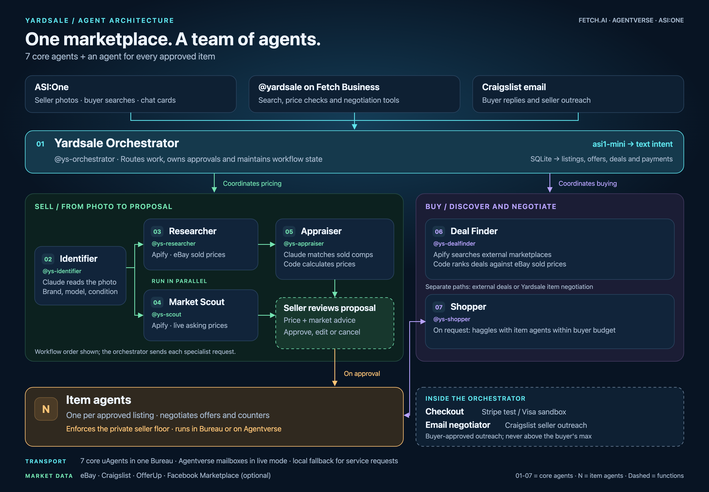

# Yardsale agent structure



[Editable SVG](agent-structure.svg) · [Full-resolution PNG](agent-structure.png)

## Design brief

Show the repo's agent structure in the spirit of ResourcePilot: a central orchestrator,
clearly named specialists, midnight navy and cyan styling, and legible workflow connections.
Keep the seller pricing path green, the buyer path purple, and dynamic item agents amber.
Include all seven core agents, plus one item agent per approved listing. Distinguish
orchestrator functions from independently addressed agents. The diagram describes the
implementation, not a claim that every integration has been verified live.

## Source grounding

- `yardsale/bureau_server.py`: `build` creates the five specialist services, Shopper,
  and Market/Orchestrator. `price_photo` calls Identifier, runs Researcher and Market Scout
  concurrently, then calls Appraiser. The Scout informs market advice; its results do not
  determine the Appraiser's sold-comparison price.
- `yardsale/shopper.py`: `haggle_all` negotiates with multiple item agents concurrently,
  within the buyer's maximum. Deal Finder and Shopper are distinct buyer paths; external
  listings do not become Yardsale item agents.
- `yardsale/relay.py`: live specialist requests use Agentverse mailboxes with an in-memory
  fallback and deduplication. Local replies need not travel through Agentverse.
- `yardsale/checkout.py` and `yardsale/craigslist_mail.py`: payment handling and email
  negotiation are orchestrator functions, not separate uAgents.
- `README.md`: current agent handles, entry points, optional Facebook Marketplace,
  item-agent hosting, private seller floor, and test-only payment providers.

Arrows inside the pricing lane show workflow dependencies coordinated by the Orchestrator;
they do not imply direct specialist-to-specialist messages. The approval gate applies to the
seller photo workflow shown here. The lower Shopper connection shows offers and counters with
item agents. Internal functions are dashed; core agents are numbered 01–07.

## Regenerate

```bash
uv run python scripts/make_agent_diagram.py
```

Requires Chrome or Chromium. Rendering is local and calls no product services. The source
is an 1800 × 1250 SVG; the PNG is rendered at 2× (3600 × 2500) for slides and zooming.
The earlier `architecture.svg` and dark variant remain available as previous diagrams.
